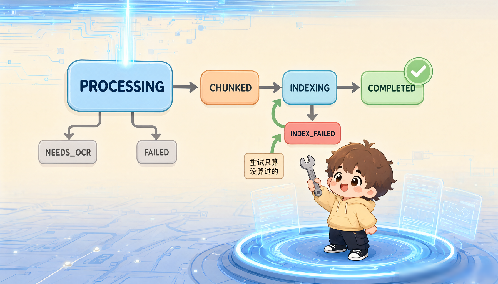

# 05｜索引：为什么"索引"按钮要你手动点


> 上篇切好的块躺在数据库里，但向量字段是空的。
> 按很多教程的写法，这里应该自动开始向量化了。
>
> 我们没有。这一篇讲清楚为什么。

**预计阅读：10 分钟**

---

## 本篇你能学到

- 上传之后系统到底做了什么（异步摄入流水线全貌）
- 为什么"先切块、人工确认、再向量化"能省下真金白银
- 文档状态机的 7 个状态和 4 条流转规则
- 批处理为什么是 10，以及失败重试是怎么做到不重复计费的

---

## 一、上传之后，系统在干嘛？

你点完上传，请求立刻返回了，但文档还在处理。

```text
函数 处理上传(文件, kbIds, parseMode):
    文档ID ← 摄入流水线.接收(文件名, 文件类型, 文件大小, 文件流, parseMode)
    返回 202已接收:
        documentId ← 文档ID

    # 202 表示"已收下，还在处理"，不是 200
    # 前端拿这个 ID 去轮询状态
```

**返回 202 Accepted = 已接收，还在处理。** 前端会轮询状态：文档列表页 2.5 秒一次，文档详情页 2 秒一次。

### 为什么要异步？

解析一个 50MB 的 PDF 可能要几十秒，云端解析可能几分钟。**让 HTTP 请求等这么久，网关会超时、用户体验也崩。** 所以丢给后台线程池慢慢跑。

### 一个很容易踩的坑：临时文件

```text
❌ 错误：直接把上传文件丢给后台任务去解析
    后果：请求一返回，底层临时文件就被删了，后台任务读到的是空气

✅ 正确：
    临时文件 ← 转存到自管目录(文档ID, 上传文件流)
    后台任务 ← 跑摄入流程(文档ID, 临时文件, ...)
```

Spring 会在请求返回时删掉 MultipartFile 的临时文件。 异步任务晚一步去读，就会报"文件不存在"。所以必须先转存到自管目录（`${java.io.tmpdir}/eon-rag`），并且在 `finally` 里清理：

```text
尝试:
    跑摄入流程(文档ID, 临时文件, ...)
捕获异常:
    把文档状态改成 FAILED，记下错误信息
无论成败最后都执行:
    删除临时文件            # ← 关键：不留垃圾
```

---

## 二、摄入流水线：5 步，最后一步单事务

```text
函数 跑摄入流程(文档ID, 临时文件, 文件类型, 文件名, parseMode):
    ① 积木序列 ← 解析路由.解析(文件字节, 文件类型, parseMode, 文件名)

    ② 父块草稿 ← 父块切分器.切(积木序列)

    ③ 遍历 每个父块草稿:
           子块草稿 ← 子块切分器.切(这个父块)     # 各父块内部独立进行

    ④ 可选：上下文前缀增强（默认关闭，会额外调模型）

    ⑤ 开一个事务，里面做三件事:
           批量插入 父块们
           批量插入 子块们（embedding 留空）
           把文档状态改成 CHUNKED，并记下父子块数量
       # 要么全成功，要么全回滚
```

两个要点：

1. **UUID 在内存里预先生成**，所以父子块可以批量插入，不用等数据库返回主键。
2. 落库是单事务：要么全成功，要么全回滚，不会出现"父块写了一半"的脏数据。

**注意第 ⑤ 步：状态置为 `CHUNKED`，embedding 字段为空。**

到这里，摄入流水线就结束了。系统停下来了，等你确认。


---

## 三、为什么要"手动点"？三个现实理由

### 理由 1：省真金白银

向量化要调模型 API，按 Token 收费。

自动向量化意味着：用户传错文件、切块参数没调好、上传了垃圾文档，钱已经花出去了。手动确认则给用户一次"反悔"的机会。

### 理由 2：让人有机会检查切块效果

分块参数（`max-tokens`、`heading-level`、重叠）因文档而异。上传后看一眼切片长什么样，比盲调参数高效十倍。

不满意？改参数重新上传，或者用切片编辑手工修，此时还没花钱。

### 理由 3：失败重试可以做到不重复计费

这是工程上最实在的好处，看下一节。

---

## 四、向量化：一条严谨的状态机

### 7 个状态

```text
PROCESSING    解析分块中
CHUNKED       切好块了，等你点索引
INDEXING      向量化中
INDEX_FAILED  向量化失败
COMPLETED     完成，可参与检索
NEEDS_OCR     疑似扫描件
FAILED        解析失败
```




### 4 条硬规则

```text
规则 1  入场检查
    如果 当前状态 不是 CHUNKED 也不是 INDEX_FAILED:
        抛错(INDEX_CONFLICT, 当前状态)

规则 2  抢占状态（乐观锁，防手抖点两次）
    更新行数 ← 把状态从 原状态 改成 INDEXING，条件: 状态必须还是 原状态
    如果 更新行数 = 0:
        抛错(INDEX_CONFLICT, "状态已被别人改了")

规则 3  只算没算过的
    待处理 ← 查出所有 embedding 为空的子块

规则 4  收尾校验
    还差几个 ← 统计 embedding 仍为空的子块数
    如果 还差几个 > 0:
        抛错(EMBEDDING_FAILED, "仍有 N 个子块没有向量")
```

**规则 2 是防重复提交的关键**：对应的 SQL 长这样

> 把这个文档的状态改成 INDEXING，但前提是它现在的状态还是我读到的那个，不是就一行都不改。

```sql
UPDATE documents SET status = 'INDEXING'
WHERE id = #{id} AND status = #{expectedStatus}
```

只有在状态确实是期望值时才更新。 用户手抖点了两次按钮，第二次的更新行数会是 0，直接被拦截。

**规则 3 是不重复计费的关键**：只查 `WHERE embedding IS NULL`。上次失败时已经算好的批次不会被重算。

### 批处理：为什么是 10？

```yaml
kb:
  embedding:
    model: text-embedding-v4
    dimensions: 1024
    batch-size: 10     # 百炼单批硬性上限，不可调大
```

**这个 10 是服务端限制，不是我们随便写的。** 调大会直接报错。

批处理循环（伪代码）：

```text
按每批 10 个切分待处理子块，逐批处理:
    本批文本 ← 每个子块的 上下文前缀 + 换行 + 正文（没有前缀就只用正文）

    向量列表 ← 向量模型.embed(本批文本)

    如果 向量列表.数量 ≠ 本批.数量:
        抛错(EMBEDDING_FAILED, "返回数量与请求不一致")   # 防止写错位置

    开一个小事务:
        遍历 本批每个子块:
            把对应向量写回该子块的 embedding 字段
```

每批一个独立事务：第 5 批失败时，前 4 批的成果已经落库了。重试时从第 5 批继续，**这就是规则 3 的价值**。


### 一次完整的向量化日志

以下为示意输出：字段与真实日志一致，数值为示例。

```text
index stage=queued  docId=7f3a… previousStatus=CHUNKED childCount=47
index stage=start   docId=7f3a… chunks=47 batches=5 batchSize=10
index stage=batch   docId=7f3a… batch=1/5 chunks=10 tokens=2460 elapsedMs=812
index stage=batch   docId=7f3a… batch=2/5 chunks=10 tokens=2380 elapsedMs=764
...
index stage=batch   docId=7f3a… batch=5/5 chunks=7  tokens=1710 elapsedMs=590
index stage=done    docId=7f3a… embedded=47 parents=12 children=47 elapsedMs=4102
```

**47 个子块、5 批、4.1 秒。** 日志里每个阶段都有耗时，性能问题一眼定位。

---

## 五、怎么确认真的完成了？

```bash
# 查文档状态
curl http://127.0.0.1:8080/api/documents/<文档ID>
```

返回结构（字段为真实结构，值为示例）：

```json
{
  "code": "OK",
  "message": null,
  "data": {
    "id": "7f3a…",
    "fileName": "产品手册.pdf",
    "status": "COMPLETED",
    "parentCount": 12,
    "childCount": 47,
    "errorMessage": null
  }
}
```

直接查数据库更直观：

```sql
SELECT
    count(*) AS 总子块,
    count(embedding) AS 已有向量,
    count(*) - count(embedding) AS 还差几个
FROM child_chunks
WHERE document_id = '<文档ID>';
```

输出示例（数值为示例）：

```text
 总子块 | 已有向量 | 还差几个
--------+----------+----------
     47 |       47 |        0
```

**「还差几个」是 0，才算真正完成。**

---

## ⚠️ 常见错误与排错

**Q1：点"向量化"返回 409 `INDEX_CONFLICT`？**

说明当前状态不允许索引。**只有 `CHUNKED` 和 `INDEX_FAILED` 能进 `INDEXING`。**

- 状态是 `PROCESSING`：还在解析分块，等一下再点。
- 状态是 `COMPLETED`：已经完成了，不用再点（要重新索引请先编辑切片或重传）。
- 状态是 `NEEDS_OCR` / `FAILED`：先解决解析问题。

**Q2：状态变成 `INDEX_FAILED` 了，怎么办？**

先看错误信息：

```bash
curl http://127.0.0.1:8080/api/documents/<文档ID>   # 看 errorMessage
```

常见原因与解法：

| errorMessage 关键词 | 原因 | 解法 |
| :--- | :--- | :--- |
| `401` / `InvalidApiKey` | 密钥错了或没配 | 检查 `DASHSCOPE_EMBEDDING_API_KEY` |
| `size mismatch` | 模型返回数量不对 | 偶发，直接重试 |
| `quota` / `限流` | 触发 API 限流 | 等一会儿重试，或降低并发 |
| `timeout` | 网络超时 | 检查网络，重试 |

修好后直接重新点"向量化"即可，已完成的批次不会重算，不重复花钱。

**Q3：文档是 `COMPLETED`，但问答时"未找到相关信息"？**

这是新手第二大坑。 检索 SQL 里有硬过滤：

```sql
AND c.embedding IS NOT NULL
AND EXISTS (SELECT 1 FROM documents d
            WHERE d.id = c.document_id AND d.status = 'COMPLETED')
```

必须同时满足"有向量"和"文档已完成"两个条件。

排查：

1. 上面那个 SQL 查一下"还差几个"是不是 0；
2. 提问时选的知识库有没有绑定这个文档？没绑任何知识库 = 全库检索；绑了别的库 = 这份文档不在范围内。

**Q4：能自动向量化吗？我不想每次手动点。**

可以，但建议至少在调试阶段保持手动。等切块参数调稳了，你可以写一个定时任务批量扫描 `CHUNKED` 状态并调用 `/api/documents/{id}/index`。不建议在摄入流水线里直接串上向量化，那样就丢掉了"失败不重复计费"的能力。

**Q5：向量化很慢，能加速吗？**

三个方向，按性价比排序：

1. **调大 `kb.thread-pool.ingest.max`**（默认 4），可以并行处理多个文档；
2. 检查网络到百炼的延迟；
3. `batch-size` 已经是上限 10，别动。

**注意 `batch-size` 是服务端硬限制**，写 20 会报错，不会变快。

---

## 本篇小结

- **上传返回 202，摄入在后台异步跑**；MultipartFile 的临时文件会随请求返回被清理，**必须先转存**。
- **摄入只做解析 + 分块，状态停在 `CHUNKED`，向量字段为空**，这是刻意设计。
- **手动点索引的三个理由**：省钱、给人工检查的机会、让失败重试不重复计费。
- **状态机 4 条硬规则**：仅 CHUNKED/INDEX_FAILED 可索引、乐观锁防重复提交、只处理空向量、完成后校验。
- **`batch-size: 10` 是服务端硬上限**，每批独立事务，失败重试只算没算过的。
- **只有 `COMPLETED` 且有向量的子块才参与检索**，这是"文档明明导入了却搜不到"的头号原因。

---

## 下一篇预告

现在数据齐了：47 个子块都带着 1024 维的向量躺在数据库里。

用户敲下问题："回调地址怎么改？"

接下来是整套系统最精彩的一段：我们同时从三个方向去找答案，按意思找、按词找、按长相找，然后把三份结果合成一份，再让模型审一遍。

下一篇揭晓：三路召回为什么能互补，以及它们各自的分数根本不在一个量纲上时，怎么公平地合在一起。

> 下一篇封面已备好（`images/cover-06.png`）：三条跑道冲向同一个漏斗。
